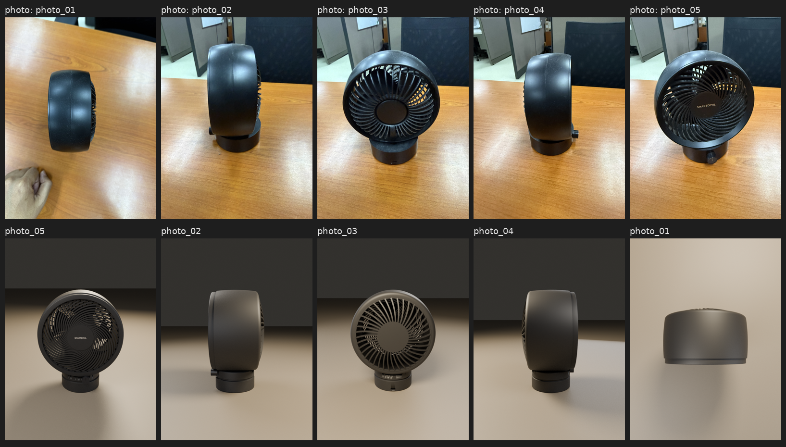
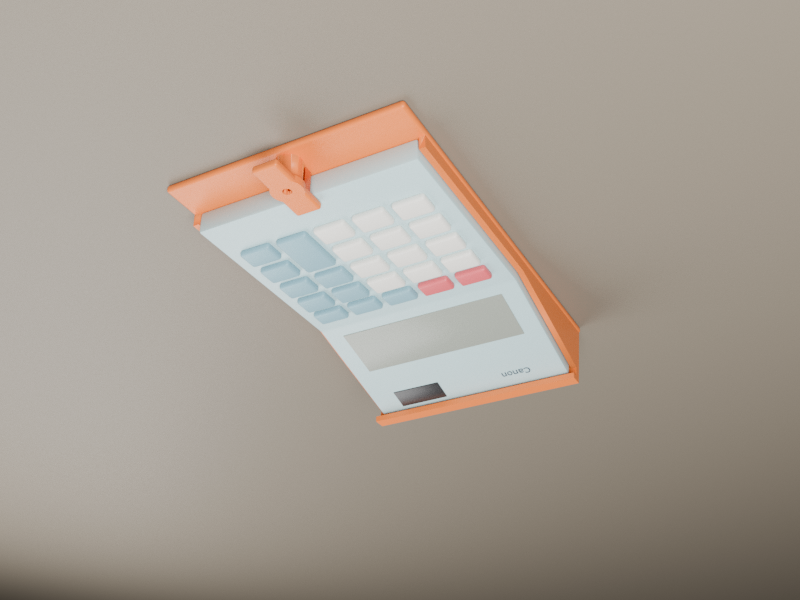

# photo-to-3d

A [Claude Code](https://claude.com/claude-code) skill that turns photos of an object into a 3D model built in
Blender. Give Claude one or more photos, plus any notes (sizes, materials, what the model is for), and it:

1. studies the photos and writes down the parts, the sizes (and where each one came from) and the camera angles;
2. writes a parametric Blender script for the object with this skill's modelling library;
3. renders the model from the same angles as your photos and puts them side by side;
4. corrects the script until the renders match, then makes the final renders;
5. delivers GLB, OBJ and `.blend` files, and for 3D printing one checked STL per printable part.

The model is an interpretation of the photos, not a measurement: Claude lists every assumption and tells you
which measurement would make it exact.



## Gallery

| model | from | what it shows |
|---|---|---|
| [water-bottle](gallery/water-bottle) | 1 photo | clear plastic, water, a printed label, a strap |
| [smartdevil-fan](gallery/smartdevil-fan) | 5 photos | 4 printable STL parts with fits; [timing](gallery/smartdevil-fan/timing.log): 39 min in all, STLs ready after 14 |
| [calculator-ceiling-mount](gallery/calculator-ceiling-mount) | 5 photos | a functional part designed around an object: a ceiling mount for a calculator, with fit checks |



Each gallery folder has the photos, the `build.py` Claude wrote, its notes, the comparison sheet and the outputs.
Rebuild any of them with `$M build gallery/NAME` (see Use for `$M`).

## Requirements

- [Claude Code](https://claude.com/claude-code)
- Blender on `PATH` (tested with Blender 5.0.1 on Ubuntu; renders use Cycles on the CPU)
- A system Python of the same version as Blender's (the installer reads it; Ubuntu's Blender 5.0 package runs
  Python 3.14), with `venv`: Blender borrows numpy (for the glTF exporter) and Pillow from an environment the
  installer makes. Builds from blender.org bundle their own Python, which this setup has not been tested with.
- The DejaVu Sans font (`fonts-dejavu-core` on Debian and Ubuntu), for the comparison sheets and for text on
  models; set `PHOTO3D_FONT` to its path if it is somewhere unusual

## Install

```bash
git clone https://github.com/lordnukem/photo-to-3d.git
cd photo-to-3d
./install.sh          # links the skill into ~/.claude/skills, makes ~/photo-to-3d/.venv, runs a check
```

To keep models and the environment somewhere other than `~/photo-to-3d`, run `PHOTO3D_HOME=/path ./install.sh` and
export `PHOTO3D_HOME` in your shell profile.

## Use

In Claude Code, attach photos and ask, for example: "Model this water bottle", or "Render this desk fan for
3D printing". Claude follows [`skill/photo-to-3d/SKILL.md`](skill/photo-to-3d/SKILL.md).

The command it uses can also be run by hand:

```bash
M=~/.claude/skills/photo-to-3d/scripts/model3d
$M check                                         # Blender, numpy, Pillow, font
$M new mug --photo mug.jpg --notes "9.5 cm tall"  # ~/photo-to-3d/models/mug with a build.py template
$M build ~/photo-to-3d/models/mug [--clay]       # preview renders + comparison sheet (~30 s per view)
$M build ~/photo-to-3d/models/mug --final        # final renders (~10 min per view on a 2-core CPU)
```

A build writes `out/NAME.glb`, `.obj`, `.blend`, `model_info.json` (sizes, parts, problems, assumptions), the
renders and `out/comparison-<quality>.png`. If `build.py` defines `PRINT_PARTS`, it also writes
`out/print/<part>.stl` in millimetres, each part merged into one solid and checked for open edges.

## What's inside

| path | what |
|---|---|
| `skill/photo-to-3d/SKILL.md` | the workflow Claude follows, the library reference and the pitfalls found in testing |
| `skill/photo-to-3d/scripts/p3d_blender.py` | the modelling library: lathe, extrude, tube, ribbon, rounded boxes, booleans, decals and text, materials from photo colours, cameras, lights, STL export |
| `skill/photo-to-3d/scripts/blender_runner.py` | builds, checks, exports and renders one model inside Blender |
| `skill/photo-to-3d/scripts/model3d.py` | the `model3d` command and the comparison sheets |
| `skill/photo-to-3d/templates/`, `skill/photo-to-3d/examples/` | starting points for a new model |

## Good at, poor at

Good at manufactured objects: bottles, cups, boxes, gadgets, furniture, tools, packaging, simple parts,
including glass, clear plastic and water. Poor at organic forms (faces, animals, plants, clothing).

## License

MIT
